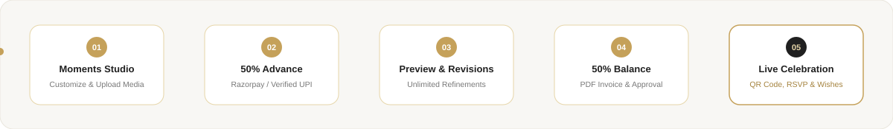
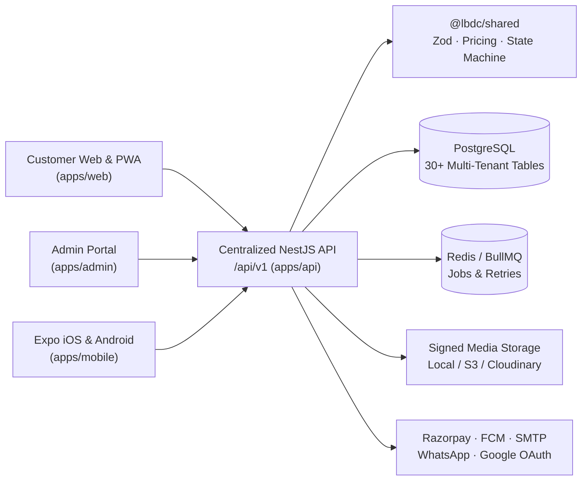

<div align="center">

<a href="https://lbdigitalcreations.in">
  
</a>

<br/><br/>


### *Luxury Bespoke Celebration Websites — Engineered as a Multi-Platform SaaS Ecosystem*

<p>
  <a href="https://lbdigitalcreations.in"></a>
  
  
  
  
</p>

<p>
  
  
  
  
</p>

</div>


## ✨ Luxury Showcase

<table>
  <tr>
    <td width="50%" align="center">
      
      <br/><sub><b>Bespoke Celebration Portals</b> — Interactive countdowns, 4K galleries, Google Maps &amp; 1-tap RSVP</sub>
    </td>
    <td width="50%" align="center">
      
      <br/><sub><b>Luxury Gold &amp; Ivory Aesthetic</b> — Consistent editorial identity across Web, PWA, Mobile &amp; Admin</sub>
    </td>
  </tr>
</table>


## 🕊️ End-to-End Customer & Fulfillment Journey

<div align="center">
  
</div>

> **Business Model Integrity:** Customers initiate any bespoke order with a **50% advance**, refine their interactive preview with **unlimited revisions** before approval, and settle the **50% balance** to unlock live public celebration hosting with instant QR sharing, guest RSVPs, and moderated wishes.


## 🏛️ Ecosystem Applications

| Application | Stack | Location | Highlights |
| :--- | :--- | :--- | :--- |
| **Customer Web & PWA** | `Next.js 15` · `React 19` · `Tailwind` | [`apps/web`](./apps/web) | 11 Celebration Categories, Template Gallery + Comparison, **Moments Studio** (autosave, media upload, AI copy), Order Tracking, Offline PWA Shell (`sw.js`), **Public Celebration Engine** (`/sites/[slug]`) |
| **Admin Web Dashboard** | `Next.js 15` · `React 19` · `Tailwind` | [`apps/admin`](./apps/admin) | Role-gated Executive KPIs, Orders, Projects, Services, Templates, Packages, Razorpay/Manual UPI Verification, Websites, Customers, Coupons, CSV Reports & Settings |
| **Mobile App (iOS & Android)** | `React Native` · `Expo` · `TypeScript` | [`apps/mobile`](./apps/mobile) | 17 Complete Screens, `SecureStore` Auth, `AsyncStorage` Offline Cache, Image Picker Uploads, Push Notifications (`expo-notifications`) & Deep Linking (`lbdc://`) |
| **Centralized Backend API** | `NestJS` · `Prisma` · `PostgreSQL` | [`apps/api`](./apps/api) | 30+ UUID Models, JWT + Refresh Token Rotation, Razorpay + Idempotent Webhooks, PDFKit Invoices, Signed Media URLs, Unified Notifications, Quota-Controlled AI & Audit Logs |
| **Shared Contracts** | `TypeScript` · `Zod` · `Vitest` | [`packages/shared`](./packages/shared) | Shared Validation Schemas, 50/50 Order Pricing Engine, Strict Project Status State Machine, and Luxury Design Tokens (`#C5A15A`, `#E6D5A8`, `#F8F7F4`) |


## 🧭 System Architecture



<details>
<summary><b>🎉 Supported Celebration Categories (11 Curated Occasions — Database-Driven)</b></summary>
<br/>

1. **Wedding** — Multi-day itinerary, couple story, 4K gallery, venue maps & RSVP
2. **Birthday** — Milestone & kids celebration portals with countdowns & wishes
3. **Anniversary** — Golden & silver jubilee timelines with ambient music
4. **Engagement** — Ring ceremony & save-the-date portals
5. **Baby Shower** — Seemantham & welcome baby invitations
6. **Naming Ceremony** — Naamkaran & cradle ceremony keepsakes
7. **Festival** — Diwali, Pongal, Eid & Christmas celebration invites
8. **Digital Invitation** — Housewarming, graduation & gala portals
9. **Love Story** — Romantic memory chapters & letters
10. **Memorial and Tribute** — Dignified life-legacy & condolence portals
11. **Custom Celebration** — Completely bespoke digital event portals

</details>

<details>
<summary><b>🔐 Security, Privacy & Production Safeguards</b></summary>
<br/>

- **Authentication & Sessions**: Short-lived JWT access tokens, SHA-256 hashed rotating refresh tokens (`user_sessions`), bcrypt password hashing, email verification, phone OTP, and Google Sign-In.
- **Strict Authorization**: Role-based access (`CUSTOMER`, `ADMIN`, `SUPER_ADMIN`) + service-layer ownership checks preventing cross-customer data access.
- **Payment Integrity**: Server-side 50/50 pricing calculation, Razorpay HMAC-SHA256 signature & webhook verification, `webhookEventId` idempotency, and mandatory admin approval for manual UPI.
- **Media & PWA Privacy**: Private uploads served solely via time-limited HMAC-SHA256 signed URLs; PWA service worker explicitly skips caching private account and API routes.
- **Status State Machine**: Enforces valid project transitions and blocks `COMPLETED` until both `FULLY_PAID` and `PUBLISHED` conditions are satisfied.

</details>


## 🚀 Quick Start

```bash
# 1. Configure environment variables
cp .env.example .env

# 2. Build shared contracts
npm install --prefix packages/shared
npm run build:shared

# 3. Setup backend, generate Prisma client, push schema & seed dev data
npm install --prefix apps/api --install-links
npx --prefix apps/api prisma generate --schema=apps/api/prisma/schema.prisma
npx --prefix apps/api prisma db push --schema=apps/api/prisma/schema.prisma
npm run db:seed

# 4. Run applications
npm run dev:api     # http://localhost:4000/api/v1
npm run dev:web     # http://localhost:3000
npm run dev:admin   # http://localhost:3001
```

### 🐳 Docker Compose (Full Stack)

```bash
docker compose up -d --build
```

### 🧪 Verification & Tests

```bash
npm run test --prefix packages/shared   # 5/5 shared pricing & state-machine unit tests
npm run test --prefix apps/api          # 3/3 API security & logic unit tests
npm run test:e2e --prefix apps/api      # 9/9 full E2E & RBAC tests against PGlite PostgreSQL
npm run build:web && npm run build:admin
```


## 📚 Documentation Suite

| Document | Purpose |
| :--- | :--- |
| [**ARCHITECTURE.md**](./ARCHITECTURE.md) | Monorepo layout, multi-tenant foundation & project status state machine |
| [**DATABASE.md**](./DATABASE.md) | PostgreSQL 30+ model schema, migrations & development seeding |
| [**API_DOCUMENTATION.md**](./API_DOCUMENTATION.md) | Complete REST endpoint reference (`/api/v1`) |
| [**DEPLOYMENT.md**](./DEPLOYMENT.md) | Subdomains, external credentials checklist, Docker, EAS mobile builds & backups |
| [**SECURITY.md**](./SECURITY.md) | Authentication, signed URLs, webhook verification & DPDP compliance |
| [**PROJECT_STATUS.md**](./PROJECT_STATUS.md) | Live phase tracker & verified capability checklist |


<div align="center">

**LB Digital Creations** · `Creating Websites for Your Special Moments`  
🌐 [lbdigitalcreations.in](https://lbdigitalcreations.in) · ✉️ [lbdigitalcreations7326@gmail.com](mailto:lbdigitalcreations7326@gmail.com) · 📸 [@lb_digital_creations](https://www.instagram.com/lb_digital_creations)

</div>
